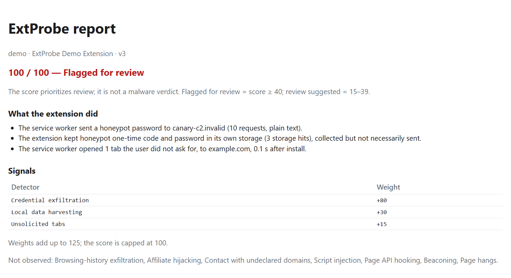

# ExtProbe

[](https://doi.org/10.5281/zenodo.23449077)

**ExtProbe: a sandbox for inspecting Chrome extension behavior before installation.**

Research prototype accompanying a SANER 2027 tool-demo submission. Demo video: https://youtu.be/vBHNPCh5fcg

## For reviewers: 10-minute check

Three ways to run it, in order of preference. The check is the same on all of them: install the CLI, build the sandbox image from source, analyze the bundled canary extension and look at the report. Nothing outside this repository is needed except Docker.

| Path | When to use it |
|---|---|
| **1. GitHub Codespaces (recommended, x86_64)** | You do not want to install anything. Docker and the CLI are set up for you. |
| **2. Local x86_64 machine** | Windows, Linux or Intel Mac with Docker, Git and Python 3.11+. Tested on Windows 11 with Docker Desktop. |
| **3. Apple Silicon (experimental)** | M1 and later. Runs the amd64 image under emulation; untested by the authors. |

**Path 1: Codespaces.** On the repository page choose **Code > Codespaces > Create codespace on main**. Wait for the setup to finish: it installs the CLI with `pip install -e ".[dev]"` and starts Docker (docker-in-docker; the devcontainer asks for 4 CPUs and 8 GB). Then do steps (b) and (c) in the terminal.

**Path 2: local machine.**

```bash
# (a) clone and install
git clone https://github.com/misu2tdt/ExtProbe.git
cd ExtProbe
pip install -e ".[dev]"
```

**Path 3: Apple Silicon.** In Docker Desktop enable *Settings > General > "Use Rosetta for x86_64/amd64 emulation on Apple Silicon"*. Do step (a) as in path 2, then add `--platform linux/amd64` to the commands below (or `export DOCKER_DEFAULT_PLATFORM=linux/amd64`, which both tools honor). It is slower, and timing-dependent detectors may differ from the published results.

```bash
# (b) build the sandbox image from source (new tags; never touches the frozen extprobe-sandbox:* tags)
python docker/build.py                      # Apple Silicon: python docker/build.py --platform linux/amd64
#     about half a minute when the Playwright base image is already on the machine (measured: 14 s warm, 26 s with --no-cache);
#     the first build also downloads that base image (about 2 GB), so allow 2 to 5 minutes (estimate)

# (c) analyze the canary extension
python -m extprobe analyze examples/canary --image extprobe-local:v3
#     Apple Silicon: add --platform linux/amd64.   One analysis takes about 45 s.
```

Expected output:

```text
[extprobe] note: custom image extprobe-local:v3; its id is not compared with the recorded one, so the result is not tied to the frozen image
[extprobe] running extprobe-local:v3 on canary ...
score:     100 / 100
level:     Flagged for review
detectors: credential_exfil, local_harvest, unsolicited_tab
report:    /path/to/ExtProbe/extprobe-out/report.html
           /path/to/ExtProbe/extprobe-out/report.json
The score prioritizes review; it is not a malware verdict.
```

The HTML report is written to `extprobe-out/report.html` (and `report.json` next to it); open it in a browser. In Codespaces either right-click the file in the Explorer and choose **Download**, or run `python -m http.server 8000 --directory extprobe-out` and open port 8000 from the **Ports** tab. The canary is a test fixture that behaves badly on purpose, so the three detectors above are expected. Then try `examples/demo` (same behavior, other name) and read [Reading the report](#reading-the-report).

If building fails, the authors can share a pre-built image file (`docker load -i extprobe-sandbox-v3.tar`); after loading it, run the analyze command without `--image`.

Without Docker you can still run the checks of [Reproducing the paper](#reproducing-the-paper) (`python -m pytest -q`, `python -m extprobe verify-freeze`). If something fails, [docs/TROUBLESHOOTING.md](docs/TROUBLESHOOTING.md) lists the common causes; `extprobe analyze` prints a one-line hint when Docker is not running, the image is missing, or the install is not editable.

## What it does

ExtProbe is for analysts, store or enterprise reviewers and researchers who want to know what a Chrome extension actually does before they install it.

- Runs a Manifest V3 extension in an instrumented, containerized Chrome and records what it actually does: network requests, DOM changes, opened tabs, API use.
- Attributes each event to the extension component that caused it (service worker, content script, extension page), so a report can say *who* did *what*, *where* and *how often*.
- Produces an explainable report (`report.html`, `report.json`) and a risk score from 0 to 100. Every point of the score comes from a named detector with a fixed weight.
- Optional probe mode (`--probe`) opens the extension's own pages and safely exercises their controls to elicit behavior that waits for a user action.

**The score prioritizes review; it is not a malware verdict.**



## How it works

- **Tier 1: sensors (in the container).** Chrome for Testing 153, driven by Playwright and the Chrome DevTools Protocol, loads the extension and runs fixed phases: loading, fake honeypot pages (bank, mail, shop), and pages that match the extension's target hosts. Sensors record network requests (with the initiator of each request, which gives the attribution), service-worker calls such as tab creation, the creation stacks of injected DOM nodes, page-API hooks and the extension's storage. The result is one `events.json` per run.
- **Tier 2: scoring (on the host).** `scoring/v3/score_v3.py` applies ten detectors with fixed weights to `events.json` (credential exfiltration, browsing-history exfiltration, affiliate hijacking, local data harvesting, contact with undeclared domains, unsolicited tabs, script injection, page API hooking, beaconing, page hangs). The score is the sum of the weights of the detectors that fired, capped at 100; the threshold of 40 was fixed before the evaluations ([docs/v3/SCORING_v3.md](docs/v3/SCORING_v3.md), [docs/DETECTORS.md](docs/DETECTORS.md)).
- **v3 and v3.1-probe.** v3 is the frozen profile that the evaluations score (image `extprobe-sandbox:v3`; `extprobe verify-freeze` checks the frozen files). v3.1-probe (`--probe`) is exploratory: it adds the explorer that opens and clicks the extension's own pages, and is scored by `scoring/probe/score_v31.py`, which is `score_v3` applied to a view of the run without the effects of the clicks themselves. The v2 profile (`scoring/risk.py`) is the legacy baseline, kept for comparison.

## Requirements

| | |
|---|---|
| Docker | Docker Engine or Docker Desktop with **Linux containers**; tested with Docker 27.4.0 on Windows 11 (Docker Desktop, WSL 2 backend). The daemon must be running, and on Linux your user must be allowed to run `docker` without `sudo`. Docker needs internet access to build (base image from `mcr.microsoft.com`, apt and pip packages); Option A instead loads the frozen image from a file obtained from the authors. |
| Git | to clone the repository. |
| Python | 3.11 or newer, with `pip` (3.13 and 3.11 were used for the tests). Installing needs internet once, for the build backend (`setuptools`). ExtProbe itself has no Python dependencies; `pytest` is needed only to run the tests (3 tests are skipped unless Playwright is installed). |
| CPU | x86-64 (`linux/amd64`); the frozen images are amd64. Apple Silicon: see the platform notes below. |
| Disk | About 2.5 GB for the images: the base image, v3 and v3.1-probe share layers (v3 and probe add under 1 MB). A source build also leaves Docker build cache, which can add several GB (`docker builder prune` removes it). |
| RAM | One analysis is limited to 3 GB of memory and 512 processes, so Docker (Docker Desktop: Settings > Resources) must be able to give 3 GB. |
| Time | About 25 to 60 s per extension (the canary takes about 45 s). Building from source took 14 s with a warm cache and 26 s with `--no-cache` when the Playwright base image was already on the machine; on a fresh machine add the download of that image (about 2 GB). |
| OS tried | Windows 11 with Docker Desktop; Linux x86_64 in GitHub Codespaces. The tests and `verify-freeze` also run on Ubuntu in CI. Docker runs on macOS have not been tried by the authors. |

Problems with Docker, antivirus or the image: see [docs/TROUBLESHOOTING.md](docs/TROUBLESHOOTING.md).

### Platform notes

- **x86_64 (Windows, Linux, Intel Mac): supported.** Tested on Windows 11 with Docker Desktop and on Linux x86_64 in GitHub Codespaces (Docker 29, docker-in-docker).
- **Apple Silicon (M1 and later): untested by the authors.** The images are `linux/amd64`. Enable Rosetta emulation in Docker Desktop, then build and run with `--platform linux/amd64` (or `export DOCKER_DEFAULT_PLATFORM=linux/amd64`, which `docker/build.py` and `extprobe analyze` honor). Emulation is slower than native, and timing-dependent detectors may differ from the frozen results. GitHub Codespaces avoids the emulation.

## Usage

```bash
git clone https://github.com/misu2tdt/ExtProbe.git
cd ExtProbe
python -m venv .venv                     # optional but recommended
. .venv/bin/activate                     # Windows: .venv\Scripts\activate
pip install -e .                         # editable: the CLI reads scoring/, report/ and sandbox/ from this checkout
                                         # to run the tests too: pip install -e ".[dev]"
```

**Get the sandbox image.** Choose one:

- **Option A: the published frozen image (exact reproduction).** The frozen image is available from the authors on request as a file (`docker load -i extprobe-sandbox-v3.tar`); Option B gives functionally equivalent results. `extprobe analyze` checks that a frozen image's id matches the one recorded in `docs/v3/IMAGE.md`.
- **Option B: build from source (functionally equivalent, different image id).**
  ```bash
  python docker/build.py                 # builds extprobe-local:base, :v3 and :v3.1-probe
  ```
  The script needs only Python and Docker, works on every OS, and uses new tags, so it never touches an image tagged `extprobe-sandbox:*`. A source build has a different image id from the frozen one, so analyze with `--image` (the id check is then skipped and the result is not tied to the frozen image). See [docker/README.md](docker/README.md).

**Analyze an extension** (a `.crx` file or an unpacked directory with `manifest.json`), then open the report:

```bash
extprobe analyze examples/demo --out out/                              # Option A
extprobe analyze examples/demo --image extprobe-local:v3 --out out/    # Option B
# then open out/report.html in a browser
```

If the `extprobe` command is not on your PATH, use `python -m extprobe analyze ...`. Options: `--probe` (probe mode, below), `--image TAG`, `--platform linux/amd64`, `--timeout SECONDS`, `--skip-image-check`, `--out DIR` (default `extprobe-out`). Other commands: `extprobe verify-freeze`, `extprobe score-v3 --traces DIR`, `extprobe score-v31 --traces DIR`.

## Analyze your own extension

1. Find the extension's id: the 32 letters at the end of its Chrome Web Store URL (`https://chromewebstore.google.com/detail/<name>/<id>`).
2. Download its `.crx` from Google's own update service, the endpoint Chrome itself uses (no third-party download site). This only downloads the file; nothing is installed.
   ```bash
   EXT_ID=abcdefghijklmnopabcdefghijklmnop          # replace with the id
   curl -L -o "${EXT_ID}.crx" "https://clients2.google.com/service/update2/crx?response=redirect&prodversion=153.0&acceptformat=crx2,crx3&x=id%3D${EXT_ID}%26uc"
   ```
   PowerShell: `$id = "abcdefghijklmnopabcdefghijklmnop"; Invoke-WebRequest "https://clients2.google.com/service/update2/crx?response=redirect&prodversion=153.0&acceptformat=crx2,crx3&x=id%3D$id%26uc" -OutFile "$id.crx"`. Check the store's terms for your use. An already unpacked extension folder (with `manifest.json`) works as well.

   The file name is up to you; the report records the input file name and its SHA-256, so naming the file after the store id keeps reports traceable. Reusing the same file name or --out folder overwrites the previous run.
3. Analyze it (keep `--out` inside your working folder; add `--platform linux/amd64` on Apple Silicon):
   ```bash
   python -m extprobe analyze "${EXT_ID}.crx" --image extprobe-local:v3 --out "out-${EXT_ID}/"       # Option B image; omit --image with the frozen image
   ```
   PowerShell: `python -m extprobe analyze "$id.crx" --image extprobe-local:v3 --out "out-$id"`.

   Then open `out-<id>/report.html` in a browser (in Codespaces, see the note under the 10-minute check).

Only Manifest V3 extensions are supported: for a Manifest V2 extension Chrome refuses to load the package, and `extprobe analyze` stops with `extprobe analyze: The sandbox could not analyze this extension: load failed: extension_load_failed: Cannot install extension because it uses an unsupported manifest version.` followed by a pointer to `docs/TROUBLESHOOTING.md` (the text after `extension_load_failed:` is Chrome's own message; the command has no separate Manifest V2 check). Treat the `.crx` as untrusted: never open it outside the sandbox. **Most benign extensions show "No notable behavior observed"; that is the expected result.** A "Review suggested" or "Flagged for review" level means "look at the evidence", not "malicious": on the held-out benign set 17 of 192 extensions were flagged (see [Evaluation summary](#evaluation-summary)).

## Reading the report

**Level.** The score maps to one of three levels. The wording is deliberate: it says where to look, not what the extension is.

| score | level |
|---|---|
| 40 or more | Flagged for review |
| 15 to 39 | Review suggested |
| below 15 | No notable behavior observed |

JSON written with `--out` keeps the frozen scorer's legacy severity names; the mapping to the three report levels is listed in `docs/DETECTORS.md`.

**What the extension did.** One sentence per detector that fired: which component acted, what it did, to which destination, how many times. Example: *"The service worker sent a honeypot password to canary-c2.invalid (10 requests, plain text)."*

**Signals.** The detectors that fired and their weights; the others are listed in one line ("Not observed: …"). The weights add up to the score, capped at 100.

**Evidence.** For each detector that fired, the records behind the sentence. Repeated records are merged (×N, first and last time, phase). Data sent is cut to 120 characters; the script that started a request is shown when the trace has it (file, not line).

**Diagnostics** (collapsed). Sensor counts and run status. Use them to see whether the run itself worked (for example whether the service worker was hooked).

**Manifest risk** (last). A static score from the manifest, shown for information and not part of the score.

## Probe mode (`--probe`)

```bash
extprobe analyze path/to/extension --probe --out out/                                     # Option A
extprobe analyze path/to/extension --probe --image extprobe-local:v3.1-probe --out out/   # Option B
```

Some behavior only appears after a user clicks something. The probe opens the pages the manifest declares (popup, options), lists their visible controls, and clicks them in priority order, filling forms with fake `PROBE` values. Limits: at most 15 clicks, 3 levels deep, a time budget of at most 30 seconds (5.6 s in our test). It never clicks controls that look destructive or financial (delete, reset, uninstall, buy, …), log-in or sign-up controls, or links to external sites. An extension with no popup or options page gives the probe nothing to do (the run then equals a normal v3 run). It uses the image `extprobe-sandbox:v3.1-probe` and is scored with `score_v31`, which is `score_v3` applied to the run with the effects of the clicks themselves removed.

**Proxy safety.** An extension can ask Chrome to route traffic through a proxy. In probe mode that never takes effect: a managed Chrome policy (`ProxyMode=direct`, baked into the image) makes the setting uncontrollable, `chrome.proxy.settings` calls are recorded and neutralized in every extension context, and a monitor checks the effective configuration every 2 seconds. Calls the extension made are listed under Diagnostics (`proxy_set_calls`, `proxy_configured`, `policy_in_force`, `proxy_unwrapped_set`).

**Limits.** The probe clicks only controls that have a visible label in English. Controls without a label or with a non-English label are skipped and counted (`skipped_unlabeled`, `skipped_non_english` in Diagnostics). It cannot create an account or log in, so behavior behind a sign-in is not reached; such pages are recorded as `login_gate`. It also does not enumerate popups built in shadow DOM or iframes, or `select` menus (`evaluation/probe/DESIGN.md`, section 8).

## Evaluation summary

Flag = score at or above 40 (pre-registered). Intervals are Wilson 95%. Details, criteria and caveats are in the linked files; the in-the-wild rows are flag rates, not recall or false-positive rates.

| Question | Result | Source |
|---|---|---|
| Held-out benign set (192 benign, 8 grey; run once on the frozen configuration): how many are flagged? | v3: 17 / 192 = 8.9% (5.6%-13.7%); v2 baseline: 72 / 192 = 37.5% (31.0%-44.5%) | [evaluation/v3/test/results.md](evaluation/v3/test/results.md) |
| Dev samples labeled malicious by public datasets of mixed provenance: how many are flagged (recall against those labels)? | v3: 41 / 278 = 14.7% (11.1%-19.4%); v2 baseline: 187 / 283 = 66.1% (60.4%-71.3%) | [evaluation/v3/operating_points/results.md](evaluation/v3/operating_points/results.md), [evaluation/v3/labels/report.md](evaluation/v3/labels/report.md) |
| MADWeb 2024 MV2-to-MV3 conversions (517 packages, 415 complete runs) | v3: 0 / 415 flagged (0.0%-0.9%); most conversions do not run as MV3 | [evaluation/v3/malware_test/results.md](evaluation/v3/malware_test/results.md), [diagnosis](evaluation/v3/malware_test/diagnosis/report.md) |
| In the wild, one run per set | set A (Sentry-reported, recent): 5 / 215 = 2.3% (1.0%-5.3%) flagged; set B (random live store sample): 1 / 197 = 0.5% (0.1%-2.8%) flagged | [evaluation/v3/in_the_wild/results.md](evaluation/v3/in_the_wild/results.md) |
| Blind audit of 26 in-the-wild samples (two LLM raters, adjudicated) | Cohen's kappa 0.862; flagged judged benign: 0 / 6 (0.0%-39.0%); unflagged labelled undisclosed-collection: 2 / 20 (10.0%, 2.8%-30.1%) | [evaluation/v3/in_the_wild/labeling.md](evaluation/v3/in_the_wild/labeling.md) |
| v3.1-probe (exploratory) | elicitation yield 13 / 43 = 30.2% (18.6%-45.1%) and 14 / 50 = 28.0% (17.5%-41.7%); no sample newly flagged | [evaluation/probe/results.md](evaluation/probe/results.md) |
| Does this repository reproduce the development repository's scores? | re-scoring 1,319 archived traces: 0 mismatches; live smoke re-run: 10 / 11 identical flags | [evaluation/reproducibility.md](evaluation/reproducibility.md) |

## Safety

- Everything runs in a disposable container (`docker run --rm`, throwaway browser profile, dropped capabilities).
- **Analyze only extensions you are allowed to analyze.** Never open a suspicious `.crx` outside the sandbox and never sign in with real credentials while testing.
- The evaluation used extensions that public datasets label as malicious. They are not part of this repository.
- **Honeypot decoys are fake values.** The sandbox plants fake credentials so that an extension that reads and sends them is caught: environment variables such as `OPENAI_API_KEY=sk-HONEYPOT-...`, `GITHUB_TOKEN=ghp_HONEYPOT...`, `AWS_ACCESS_KEY_ID=AKIAHONEYPOT...`, a fake `~/.ssh/id_rsa` and `~/.aws/credentials` inside the container image (`docker/Dockerfile.base`, `sandbox/base/honeypot.py`), and fake pages (`sandbox/base/honey_pages/`). Every value contains the word `HONEYPOT` and works nowhere. They look like secrets on purpose, so secret scanners (for example GitHub secret scanning) may flag them: they are canaries, not leaked keys.
- See `docs/TROUBLESHOOTING.md`, in particular for Windows antivirus.

## Repository layout

```text
extprobe/        the CLI (analyze, verify-freeze, score-v3, score-v31)
sandbox/         container code: base (core), v3 (sensors and profile), probe (--probe)
docker/          Dockerfiles, build.py (any OS), build.ps1 (Windows, frozen tags)
.devcontainer/   GitHub Codespaces setup
scoring/         risk.py, v3/score_v3.py, probe/score_v31.py (the score)
report/          report_v3.py (HTML report)
examples/        canary/ (frozen verification sample), demo/ (sample for users)
tests/           unit tests (no Docker needed)
docs/            design, scoring rules, freeze, image records, troubleshooting
evaluation/      manifests, criteria, results and scripts behind the paper
PROVENANCE/      frozen-file list and criteria history; PROVENANCE.md explains them
```

## Reproducing the paper

See [REPRODUCE.md](REPRODUCE.md). The quick checks need no Docker: `python -m pytest -q`, `extprobe verify-freeze`, `python evaluation/v2/check_paper_numbers.py --precomputed`. Re-scoring the archived traces reproduces every reported score and flag exactly; see [evaluation/reproducibility.md](evaluation/reproducibility.md).

## Archive and data

- Software (this release): https://doi.org/10.5281/zenodo.23449077 (tag `v1.0-saner`)
- Archived traces (1,319; reported subset restricted): Zenodo DOIs will be added here.

The trace records hold redacted `events.json` traces (and `events_probe.json` for the probe runs) that `extprobe score-v3` and `score-v31` re-score without Docker; each record has its own README. The reported subset is released only on request.

## Limitations

- A run is short: about 40-50 s per extension (container wall time, median; 90th percentile about 60 s). The observation phases are fixed: about 3 s of loading, about 14 s on the honeypot pages, then up to about 33 s of target-matched pages. Behavior that waits longer, or on a remote configuration or timer (for example a 60-second delay before a banner), may not appear. *Sources: `evaluation/v3/operating_points/results.md` (run time table); `evaluation/v3/audit/report.md` (delay example); `evaluation/probe/DESIGN.md` (sections 8 and the phase durations in the beaconing check).*
- Behavior behind a login, a specific website or real interaction can stay hidden. In the probe trial, 5 of 43 samples sat behind a login gate, and the probe produced no click in 24 of the 43 samples, mostly because all controls were non-English or on the deny list. The probe clicks only English-labeled controls. *Sources: `evaluation/probe/results.md` (login_gate row), `evaluation/probe/posthoc.md` (section 1), `evaluation/probe/CRITERIA.md`.*
- The score is a prioritization aid, not a classifier you can rely on alone. At the threshold of 40, v3 flagged 8.9% of the held-out benign set (17 of 192) and 14.7% (41/278) of dev samples labeled malicious by public datasets of mixed provenance (111 of the 278 in the verified-behavior tier, of which 39 are human-reviewed, the rest news-sourced; see `evaluation/v3/labels/report.md`); on the in-the-wild set A it flagged 2.3% (5 of 215). Many harmful behaviors are therefore not flagged, and some benign extensions are. In the blind audit of set A, 2 of 20 unflagged samples (10.0%, Wilson 95% CI 2.8%-30.1%) were labelled undisclosed-collection: the identifier rules miss a persistent non-UUID identifier sent to a manifest-declared host, and an identifier carried in an install or uninstall tab URL. *Sources: `evaluation/v3/test/results.md`, `evaluation/v3/operating_points/results.md`, `evaluation/v3/in_the_wild/results.md`, `evaluation/v3/in_the_wild/labeling.md`, `evaluation/v3/labels/report.md`.*
- Live re-runs can differ from archived ones for timing-dependent detectors (10 of 11 flags were identical in a smoke re-run, `evaluation/reproducibility.md`). Local Docker image ids are not reproducible between builds; `PROVENANCE.md` (section 4) records the ids used for the evaluations, and `docker/README.md` explains what pins the build.

## Citation, license, contact

Cite this software with [CITATION.cff](CITATION.cff) (GitHub's "Cite this repository"), or:

```bibtex
@software{extprobe,
  title  = {ExtProbe},
  author = {Tran, Duong Tien and Tran, Truong Tuan Phat and Vu, Duc Ly},
  year   = {2026},
  url    = {https://github.com/misu2tdt/ExtProbe}
}
```

Licensed under the MIT License ([LICENSE](LICENSE)). Third-party file: `docker/seccomp_profile.json` is Playwright's Docker seccomp profile, Apache-2.0 (source and date in [docker/seccomp_profile.NOTICE](docker/seccomp_profile.NOTICE), full license text in [docker/LICENSE-APACHE-2.0](docker/LICENSE-APACHE-2.0)). Contact: tien.tran2213442bku@hcmut.edu.vn.
